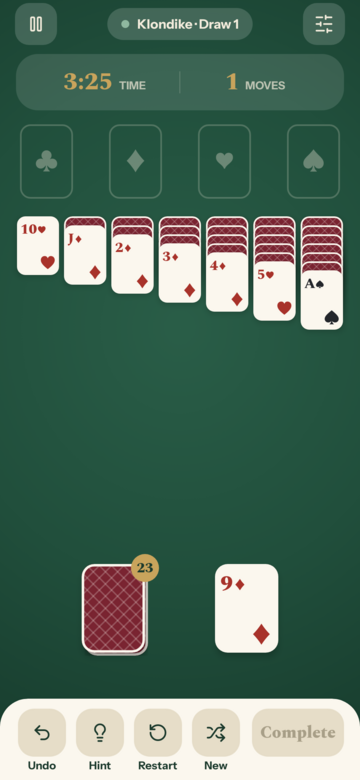
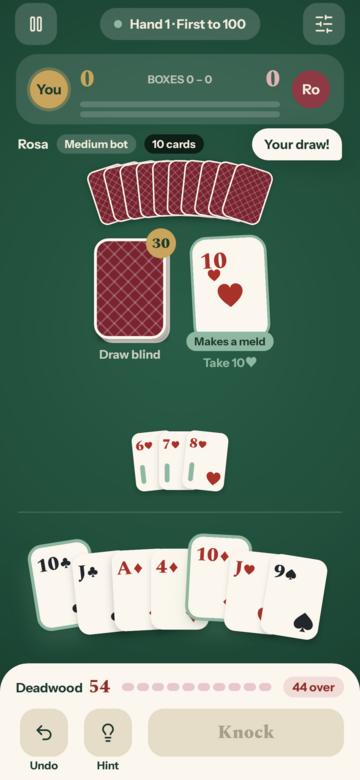

# Parlour Cards

[](https://github.com/alexwitting/parlourcards/actions/workflows/cardgames.yml)

An offline Android app of classic card games — **Klondike Solitaire** and **Gin Rummy** against an
AI opponent — built with Kotlin and Jetpack Compose. No ads, no analytics, no network.

<p align="center">
  
  
</p>

## Features

- **Klondike Solitaire** — draw 1 or draw 3, with optional winnable deals.
- **Gin Rummy** — against an AI opponent at three difficulties.
- Save and resume, undo and redo, hints, and stats for every game.
- Four themes, sounds and haptics, and Card speed and Reduce motion settings.
- Fully offline; everything is stored on the device.

## Building

Requires JDK 21 and the Android SDK (set `ANDROID_HOME`, or `sdk.dir` in `local.properties`). The
app targets `minSdk 26` / `targetSdk 35`.

```bash
./gradlew assembleDebug        # "Parlour Cards Dev" — installs beside the release build
./gradlew installDebug
./gradlew installRelease       # the minified (R8) build, signed with the debug key for local testing
```

Release builds are signed with the debug key so they install for testing; swap in a real signing
config before publishing.

## Checks

CI runs these on every push and pull request to `master`:

```bash
./gradlew ktlintCheck detekt lint      # formatting, static analysis, Android Lint
./gradlew test koverVerify             # unit and Robolectric tests, per-module coverage floors
./gradlew assembleRelease              # the R8 build (and a check navigation's enum kept its name)
./gradlew verifyRoborazziDebug         # screenshot tests against committed baselines
```

After an intended visual change, re-record the screenshot baselines with
`./gradlew recordRoborazziDebug` and review the diffs in `build/outputs/roborazzi` first.

## Architecture

Multi-module (`:app`, `:feature:*`, `:core:domain`, `:core:data`, `:core:ui`, plus shared test
modules) with MVI ViewModels, Hilt, Room and DataStore, and Jetpack Compose throughout. The game
engines and the Gin AI are pure Kotlin in `:core:domain`, with no Android dependencies.

## License

MIT — see [LICENSE](LICENSE). Bundled third-party assets keep their own licences: the Spectral and
Instrument Sans fonts (SIL Open Font License 1.1) and the Lucide icon paths (ISC), with their
texts in `core/ui/src/main/res/raw/`.
